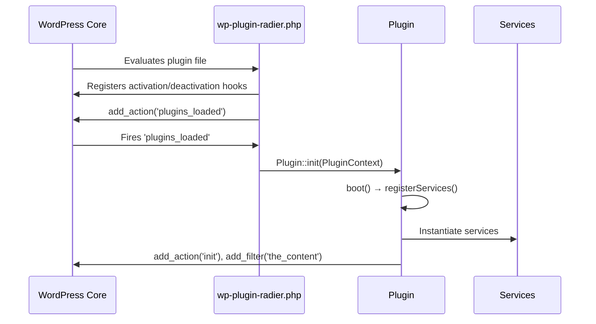

# Architecture and Lifecycle

This document describes the architectural components of the plugin scaffold and their lifecycle.

## Architectural Principles (KISS)

- **Side-Effect-Free Construction**: The `__construct()` method never registers hooks or triggers side effects.
- **Direct & Idiomatic Hooking**: `Plugin::registerServices()` wires services directly to standard WordPress hooks (`add_action`, `add_filter`), avoiding bloated loader abstractions.
- **Dependency Injection**: Classes receive configuration and context through constructor parameters.
- **Domain Decoupling**: Domain services contain business logic and do not register WordPress hooks internally.
- **Modern PHP Standards**: Strict types, readonly classes, constructor property promotion, and typed class constants.

## Core Components

### 1. `PluginContext`

`PluginContext` is an immutable value object (`final readonly class`).
It resolves and provides absolute filesystem paths, URLs, and the plugin textdomain.

```php
// The optional second argument is a custom base URL override, not a textdomain.
// The textdomain default lives in the PluginContext constructor ('wp-plugin-radier').
$context = PluginContext::fromFile(__FILE__);

$filePath = $context->path('templates/admin.php');
$assetUrl = $context->url('dist/app.js');
$langPath = $context->languagesPath();
```

### 2. `Plugin` Coordinator

The `Plugin` class coordinates plugin services and manages the application lifecycle.

- `Plugin::__construct(PluginContext $context)`: Pure dependency receiver. Zero side effects.
- `Plugin::init(PluginContext $context)`: Singleton entrypoint called by WordPress on `plugins_loaded`.
- `Plugin::boot()`: Guards against double boot, then delegates to `registerServices()`.
- `Plugin::registerServices()`: The only place hooks are wired. Registers domain services into an FQCN map and attaches them to WordPress hooks.
- `Plugin::reset()`: Resets the static singleton instance. Used by test suites between test cases to ensure complete isolation.
- `Plugin::get(class-string<T> $class): ?T`: Type-safe service accessor with full IDE autocomplete.

### 3. Domain Services

Services live in `src/Services/` and contain isolated business logic.

- `I18nService`: Handles textdomain registration on the WordPress `init` hook.
- `ExampleService`: Demonstrates content filtering and business logic with boundary defense.

## Execution Flow


